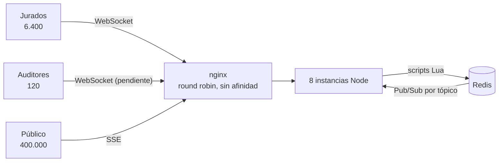

# Arquitectura

Este documento es la base del informe. Cada sección responde algo que el enunciado pide «explicar».
Lo que aún no tiene medición propia está marcado como **hipótesis**.

## Vista general



El camino de un acta:

1. `JuradoGateway` valida y llama a `submit_acta.lua`, que en una sola operación compara versiones,
   actualiza los cuatro niveles (`tally:*`) y marca los scopes como sucios.
2. El jurado recibe `acta.ack`. El acta ya es durable: Redis corre con `appendfsync always`.
3. Cada 2 s, las ocho instancias intentan `flush_window.lua` y una guarda deja pasar a una sola.
   Compara `tally:*` con `pub:*`, guarda el delta en `hist:<tópico>` y lo publica en `ch:<tópico>`.
4. Cada instancia suscrita recibe el delta y lo reparte en lotes a sus clientes de ese tópico.

## Capas

```
src/
  domain/          Reglas puras, sin I/O: acta, tópicos, recuperación, contrapresión, catálogo
  application/     Casos de uso sin transporte: fotografías, ventana de publicación, tokens
  fanout/          Registro de tópicos y envío por lotes, genéricos
  infrastructure/
    redis/         Claves, scripts Lua, repositorio, backplane, límite de tasa, salud
    metrics/       Métricas por instancia, compartidas a través de Redis
  transport/
    http/          Rutas Fastify
    sse/           Audiencia pública
    ws/            Audiencia de jurados
  main.ts          Raíz de composición: el único lugar que conoce las clases concretas
public/js/         Clientes sin build; results-state.js y backoff.js son puros y tienen pruebas
```

Regla de dependencias: `domain` no importa nada del proyecto, y solo `main.ts` conoce todo.

## Transportes (RT-5)

| Audiencia             | Transporte                  | Por qué                                                             |
| --------------------- | --------------------------- | ------------------------------------------------------------------- |
| Jurados               | WebSocket con ack por envío | Bidireccional: el servidor también debe avisar corrección o rechazo |
| Auditores             | WebSocket                   | Colaborativo, y la conexión viva sirve de señal de presencia        |
| Público               | SSE                         | Tráfico en una sola dirección, HTTP corriente                       |
| Fallback y línea base | Polling con ETag            | Lo más simple, y referencia de la comparación                       |

**Hipótesis por medir:** que SSE cuesta menos que WebSocket por conexión a esta escala. El enunciado
exige justificarlo con mediciones propias: si los datos lo contradicen, se cambia.

No usamos Socket.IO: su transporte de long polling exige afinidad de sesión, y RT-2 la prohíbe.

Tampoco usamos la reconexión nativa de `EventSource`: reintenta a intervalo fijo, lo que sincroniza la
avalancha, y su `Last-Event-ID` guarda un solo valor cuando hace falta un cursor por tópico.

## Redis, papel por papel (sección 5)

| Papel               | Estructura                      | Clave                          | Notas                                                |
| ------------------- | ------------------------------- | ------------------------------ | ---------------------------------------------------- |
| Backplane           | Pub/Sub, un canal por tópico    | `el:ch:<tópico>`               | Una instancia solo escucha lo que sus clientes miran |
| Historial           | Stream con ID explícito `seq-0` | `el:hist:<tópico>`             | `MAXLEN 300`, expira a las 24 h                      |
| Acumulado vivo      | Hash                            | `el:tally:<scope>`             | HINCRBY O(1) por campo                               |
| Acumulado publicado | Hash                            | `el:pub:<scope>`               | Lo único que lee el público                          |
| Ranking             | Sorted set                      | `el:rank:<scope>`              | ZREVRANGE top-k, sin recorrer candidatos             |
| Atomicidad          | Scripts Lua                     | `lua/*.lua`                    | Ver RF-3                                             |
| Idempotencia        | String con TTL                  | `el:idem:<idem>`               | 24 h. Ver RF-1                                       |
| Límite de tasa      | Contador con TTL                | `el:rl:<credencial>:<ventana>` | Responde `RATE_LIMITED` y `retryAfterMs`             |
| Bloqueo             | **Pendiente**                   |                                | Ver la guía                                          |
| Presencia           | **Pendiente**                   |                                | Ver la guía                                          |

**Configuración.** `appendfsync always` es asumible porque se escriben pocas actas por segundo; un
acta confirmada sobrevive a un reinicio de Redis. `maxmemory-policy noeviction` porque perder un
acumulado o un bloqueo es peor que rechazar una escritura.

**Restricciones de los scripts.** Bloquean Redis mientras corren, así que deben ser breves.
`flush_window` toca claves calculadas en tiempo de ejecución, lo que impide repartirlas en un Redis
Cluster: el diseño asume un solo primario. Su peor caso es del orden de 8.400 scopes sucios, tras una
caída larga; hay que medirlo.

## Respuestas a los requerimientos

### RF-1. Idempotencia y caída antes de confirmar

Dos líneas de defensa. La clave `idem` devuelve la respuesta original a un reenvío. Y si esa clave ya
expiró, la identidad natural `(acta, versión, huella)` detecta el duplicado: la expiración solo cuesta
la respuesta en caché, nunca un doble conteo.

**Si el servidor cae entre registrar y confirmar:** registrar es atómico, así que el acta está
completa. El jurado no recibió ack, la conserva en IndexedDB y la reenvía con el mismo `idem` a otra
instancia, que responde `duplicate` con la fecha original. Es entrega al menos una vez más
procesamiento idempotente.

### RF-2. Convergencia

El estado de un acta es el máximo de sus envíos según el orden total `(versión, huella)`. El máximo es
conmutativo, asociativo e idempotente, y por eso el orden de llegada no importa. Todo lo demás
(contado, en verificación, acumulados) se deriva solo del ganador.

Dos contenidos con la misma versión: gana la huella mayor, para ser deterministas, y el acta queda
dudosa, para que la resuelva un humano. Si ganara «el primero que llegó», el resultado dependería del
orden. Una prueba aplica todas las permutaciones de un conjunto de envíos y exige un solo estado final.

### RF-3. Atomicidad

Redis ejecuta un script completo sin intercalar otros comandos. Varios comandos seguidos desde la
aplicación no sirven por dos motivos: un lector puede colarse entre ellos, y una caída a mitad deja los
niveles descuadrados para siempre.

La escritura atómica no basta: la lectura también debe serlo. `read_snapshot.lua` lee todos los tópicos
en una sola operación, y el público lee `pub:*`, que `flush_window` actualiza por niveles completos con
una sola secuencia.

**Dudosas:** un acta dudosa no suma hasta verificarse. Publicarla obligaría a revertir después un número
que probablemente estaba mal.

### RF-4. Fan-out y la trampa de escala

- **Agregación.** Se publica por ventana de 2 s, no por acta. Dos horas son 3.600 ventanas, así que un
  cliente recibe como máximo 3.600 mensajes por tópico. La reducción depende de qué mira la audiencia:

  | Lo que mira cada cliente | Mensajes por cliente, máximo | Total con 400.000 clientes |
  | ------------------------ | ---------------------------- | -------------------------- |
  | Ingenuo: todo, por acta  | 6.400                        | 2.560 millones             |
  | `dep`, ventana de 2 s    | 3.600                        | 1.440 millones             |
  | Un municipio (~56 actas) | ~56                          | ~22 millones               |
  | Un puesto (~3,5 actas)   | ~3,5                         | ~1,4 millones              |

  **Ojo:** si casi todos miran `dep`, 2 s solo reduce a poco más de la mitad, porque fuera del pico casi
  toda ventana trae algún cambio. Si la prueba de carga lo confirma, la palanca es alargar la ventana de
  `dep` (10 s bajan el máximo a 720 mensajes) o llevar por defecto a un municipio. Estas cifras son
  cotas calculadas: **la real debe salir de `messagesEmitted` en la prueba de carga.**

- **Delta mínimo.** Solo los campos que cambiaron, en valor absoluto. Absoluto y no incremento: repetir
  una entrada o aplicarla tras una fotografía no puede contar doble.
- **Lotes.** `BatchedBroadcaster` entrega de a 500 y cede con `setImmediate`, que corre tras la fase de
  I/O: entre lotes se atienden los sockets, incluidos los de jurados.
- **Sin líder.** Las ocho instancias intentan publicar y una guarda en Redis deja pasar a una. Si muere,
  la siguiente ventana la toma otra sin elección de líder.

### RF-5. Tópicos

`TopicRegistry` mantiene dos mapas: `tópico → Set<conexión>` y `conexión → Set<tópico>`.

| Operación              | Costo                               |
| ---------------------- | ----------------------------------- |
| Alta o baja de un par  | O(1)                                |
| Baja de una conexión   | O(tópicos de la conexión), máximo 4 |
| Recorrido de un tópico | O(suscriptores de ese tópico)       |

**Canal global o por tópico:** con uno global, cada instancia recibe y descarta todo. Por tópico, cada
instancia solo recibe lo que necesita, a cambio de gestionar suscripciones. Con audiencia repartida, las
ocho estarán suscritas a `dep` de todos modos; la diferencia está en los 1.842 puestos. Hay que medirlo.

### RF-6. Continuidad

- **Qué lleva el cliente:** un cursor por tópico, la `seq` del último cambio aplicado, en la URL.
- **Qué entrega el servidor** (`domain/recovery.ts`): nada si está al día, el detalle si se puede
  demostrar que está completo, y una fotografía en los demás casos.
- **Cuándo fotografía:** cliente nuevo; cursor de otra época; hueco en el historial, detectado porque el
  `prev` de la primera entrada es posterior al cursor; o más de 30 entradas por reproducir.
- **Sin carrera:** registrar, suscribir, leer y volcar, en ese orden (`PublicStreamService.open`).
- **Autorreparación:** si a un cliente le llega un delta cuyo `prev` no coincide, reconecta con su cursor.

**Retención:** 300 entradas por tópico, al menos 10 minutos a una entrada cada 2 s, con expiración de
24 h. **La memoria consumida está por medir** con `MEMORY USAGE`.

Pub/Sub es solo el aviso rápido. La verdad está en los Streams, y `RedisBackplane` rellena desde ellos
cuando detecta un hueco o reconecta a Redis.

### RF-9. Contrapresión

Según `writableLength` de cada conexión (`domain/backpressure.ts`):

| Pendiente       | Acción                                       |
| --------------- | -------------------------------------------- |
| Menos de 64 KiB | Enviar detalle                               |
| Desde 64 KiB    | Omitir detalle; al drenar, fotografía        |
| Desde 256 KiB   | Desconectar; el cliente vuelve con su cursor |

`proxy_buffering off` en nginx es indispensable: si nginx acumulara, la instancia nunca vería al cliente
lento.

### RF-10. Degradación

**Sin Redis.** ioredis corre sin cola offline y con tiempo límite, de modo que el comando falla en vez de
quedar esperando en una memoria que puede morir. El jurado recibe `BACKEND_UNAVAILABLE` con
`retryable: true`, su acta sigue en cola y la app dice «NO registrada todavía». El público recibe
`status` y ve un aviso de datos pausados. Un timeout es ambiguo porque el script pudo aplicarse, pero el
reintento con el mismo `idem` es seguro.

**Avalancha.** El cliente espera un valor al azar entre 0 y `min(30 s, 1 s × 2^intento)`. Del lado del
servidor: rechazo barato con `Retry-After` al llegar al límite de conexiones, y fotografías con caché
breve y llamada única, para que mil reconexiones hagan una sola lectura.

### RT-2. Sin sesiones pegajosas

**Evita:** desbalance tras una caída, porque los clientes de la instancia muerta se reparten solos;
despliegues atados a la afinidad; y estado que muere con la instancia.

**Crea:** todo estado compartido debe vivir en Redis, por lo que Redis es un punto único de falla; una
reconexión puede caer en otra instancia, lo que obliga al cursor de RF-6; y los tokens deben ser sin
estado y firmados, con el costo de no poder revocarlos antes de que expiren.

## Limitaciones conocidas

Ver la sección de deuda en [PROMPT_COWORKER.md](PROMPT_COWORKER.md).
